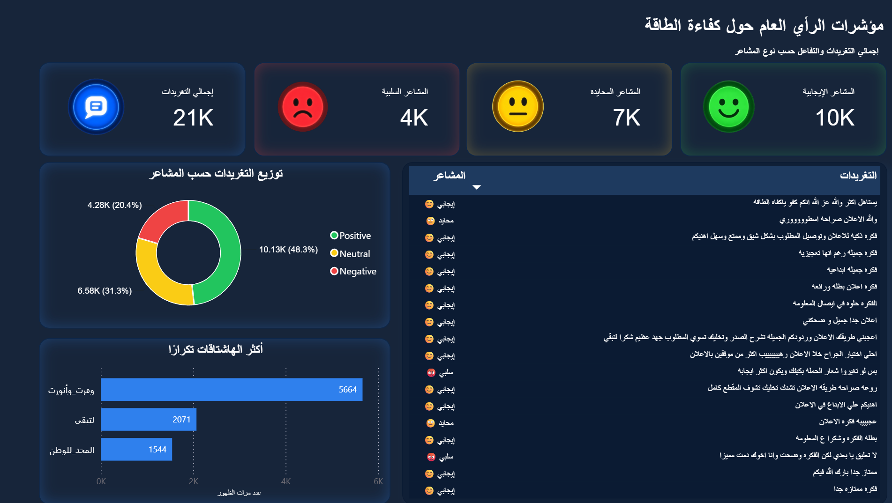

# 🇸🇦 تحليلات مشاعر الجمهور لحملة كفاءة الطاقة | Energy Efficiency Sentiment Analysis

[English Version Below](#english-version)

---

## 📌 نبذة عن المشروع
يهدف هذا المشروع إلى جمع وتحليل وإعادة معالجة التغريدات المتعلقة بالحملة الوطنية لترشيد استهلاك الطاقة (مثل حملات `#وفرت_وأنورت` و `#لتبقى` و `#المجد_للوطن`) على منصة تويتر (X)، وذلك لفهم انطباعات الجمهور ومشاعره اتجاه الحملات الإعلانية التوعوية والتفاعلية.

### 🔄 مراحل العمل (Project Pipeline):
1. **جمع البيانات (Data Extraction):** سحب التغريدات والتفاعلات المتعلقة بالحملات الإعلانية لكفاءة الطاقة.
2. **تنظيف وتجهيز البيانات (Data Cleaning & Preprocessing):**
   - معالجة وإزالة الروابط، النصوص المكررة، والتغرديات غير المرتبطة (Spam Filter).
   - تنظيف النصوص العربية (Arabic Text Normalization & Tokenization) باستخدام مكتبات Python.
3. **تحليل المشاعر (Sentiment Classification):** تصنيف التغريدات إلى 3 فئات أساسية (**إيجابي Positive**، **محايد Neutral**، **سلبي Negative**).
4. **بناء لوحة المؤشرات (Dashboard Visualization):** تصميم لوحة تفاعلية لإظهار إجمالي التغريدات، توزيع المشاعر، العينة النصية للتغريدات، وأكثر الهاشتاقات تداولاً.

---

## 📊 أبرز النتائج والمؤشرات (Key Insights)
- **إجمالي التغريدات (Total Volume):** 21K+ تغريدة.
- **توزيع المشاعر (Sentiment Distribution):**
  - **إيجابي (Positive):** **48.3%** (10.13K) - تفاعل واستحسان كبير لفكرة الإعلان وتوصيل الرسالة.
  - **محايد (Neutral):** **31
